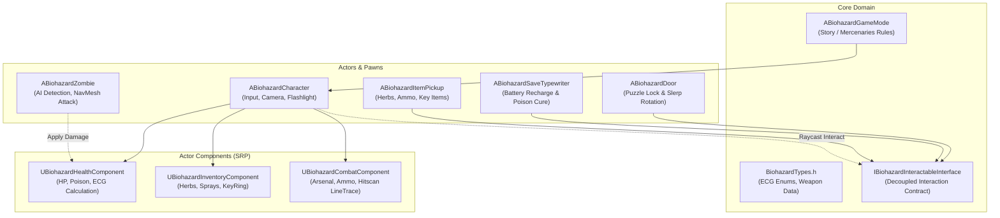

# Biohazard: Eclipse of Spencer Lab (Unreal Engine 5 Edition)

[](https://www.unrealengine.com/)
[](https://docs.unrealengine.com/5.4/en-US/gameplay-architecture-in-unreal-engine/)
[](https://www.kernel.org/)

Proyek game *Survival Horror FPS* bertema *Resident Evil* yang dibangun menggunakan **Clean Architecture & Component-Driven Design** pada **Unreal Engine 5 (C++)**.

---

## Arsitektur Komponen (Clean Architecture)

Proyek ini memisahkan tanggung jawab menggunakan **Unreal Engine Actor Components** daripada menumpuk seluruh logika di dalam satu *God Class* (*Single Responsibility Principle*):



---

## Struktur Direktori Repository (Git-Ready)

```
BiohazardUnreal/
├── .editorconfig                       # Konfigurasi indentasi Epic Games C++ standard
├── .gitattributes                      # Pengaturan Git LFS untuk aset biner (*.uasset, *.umap)
├── .gitignore                          # Filter resmi UE5 (mencegah Binaries/ & Intermediate/ ter-push)
├── README.md                           # Dokumentasi teknis proyek
├── BiohazardUnreal.uproject            # File konfigurasi utama proyek Unreal Engine
├── Config/                             # Konfigurasi engine, kontrol, dan metadata
│   ├── DefaultEngine.ini               # Optimasi performa render untuk GPU Intel Iris Xe
│   ├── DefaultGame.ini                 # Metadata game
│   └── DefaultInput.ini                # Pemetaan tombol (W/A/S/D, F, H, E, 1-4)
└── Source/                             # Kode Sumber C++ Modular
    ├── BiohazardUnreal.Target.cs       # Target build Standalone Game
    ├── BiohazardUnrealEditor.Target.cs # Target build Unreal Editor
    └── BiohazardUnreal/
        ├── BiohazardUnreal.Build.cs    # Dependensi modul (Core, EnhancedInput, AIModule, UMG)
        ├── BiohazardUnreal.h           # Module Header
        ├── BiohazardUnreal.cpp         # Module Implementation
        ├── Core/                       # Tipe data inti, kontrak interface, dan GameMode
        │   ├── BiohazardTypes.h
        │   ├── BiohazardGameMode.h / .cpp
        │   └── Interfaces/
        │       └── BiohazardInteractableInterface.h
        ├── Framework/
        │   └── Components/             # Komponen modular pemain
        │       ├── BiohazardHealthComponent.h / .cpp
        │       ├── BiohazardInventoryComponent.h / .cpp
        │       └── BiohazardCombatComponent.h / .cpp
        ├── Characters/                 # Karakter pemain dan AI musuh
        │   ├── BiohazardCharacter.h / .cpp
        │   └── BiohazardZombie.h / .cpp
        ├── Environment/                # Aktor interaktif lingkungan
        │   ├── BiohazardDoor.h / .cpp
        │   └── BiohazardSaveTypewriter.h / .cpp
        └── Items/                      # Item pickup dunia
            └── BiohazardItemPickup.h / .cpp
```

---

## Petunjuk Push ke GitHub / GitLab

Direktori ini telah dilengkapi dengan `.gitignore` dan `.gitattributes` standar Unreal Engine sehingga aman untuk langsung di-push tanpa risiko mengunggah folder *cache* raksasa:

1. **Inisialisasi Git (jika belum):**
   ```bash
   git init
   git add .
   git commit -m "feat: initial clean architecture biohazard ue5 project"
   ```
2. **Hubungkan ke Remote Repository:**
   ```bash
   git remote add origin https://github.com/username/BiohazardUnreal.git
   git branch -M main
   git push -u origin main
   ```

---

## Catatan Performa Intel Iris Xe (Linux)

Konfigurasi di `Config/DefaultEngine.ini` telah dioptimalkan agar ringan dan berjalan di 60 FPS:
* Menonaktifkan Lumen Global Illumination berat (`r.DefaultFeature.Lumen=0`).
* Menggunakan *Screen Space Reflections* dan *Baked Lighting* untuk koridor laboratorium Spencer.
